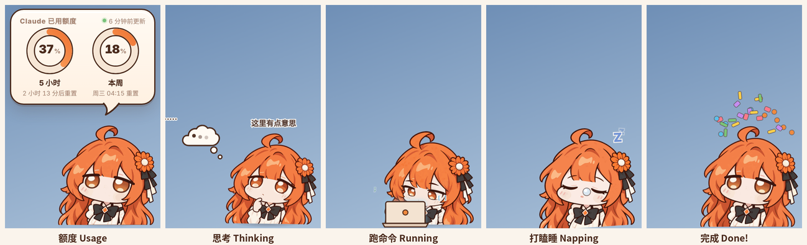

<div align="center">

# Claude Pet · Claude 额度桌宠

**一只住在桌面角落、帮你盯着 Claude 订阅额度的小桌宠。**
**A tiny desktop pet that keeps an eye on your Claude plan usage.**


[中文](#中文) · [English](#english)



</div>

---

## 中文

### 它能做什么

**看额度**
- 两个圆环显示 **五小时额度** 和 **周额度**，附带重置倒计时；数字滚动，颜色随用量从橙变红
- 用量越高小人越慌：≥80% 冒汗，≥95% 发抖；拿不到数据头上冒问号
- 五小时到 80% / 95%、本周到 75% / 90% 时弹系统通知
- Windows 托盘里是带圆环的小头像，Mac 菜单栏里直接显示 `37% · 18%`

**陪你干活**（Windows，Claude 桌面 App）
- Claude 在思考：换成托腮立绘，头边冒想法云，头顶飞过小字
- Claude 在跑命令：换成看电脑立绘，左下角出现笔记本，往外冒代码符号
- 一轮回答结束：彩纸礼花 + 「叮叮叮」

**桌宠日常**
- 摸头（点头顶）：Q 弹 + 冒爱心
- 点身体：展开 / 收起额度气泡；点气泡：说一句随用量变化的台词
- 拖到屏幕边自动吸附，贴左边时整体镜像
- 电脑 1 分钟没操作就打瞌睡（换睡觉立绘、Zzz、鼻涕泡），一动鼠标就醒
- 透明区域鼠标直接穿透，不挡你操作
- 中英双语，默认跟随系统

### 安装

**Windows（免安装）**：到 [Releases](../../releases) 下载 `Claude-Pet-win-x64.zip`，解压后运行 `Claude Pet.exe`。
程序没有签名，如果弹出「Windows 已保护你的电脑」，点「更多信息 → 仍要运行」。

**从源码运行（Windows / macOS）**，需要 Node.js 18+：

```bash
git clone https://github.com/<你的用户名>/Claude_Pet.git
cd Claude_Pet
npm install
npm start
```

打包：`npm run dist:win`（Windows zip，在 Mac / Linux 上也能打）· `npm run dist`（Mac .app）

### 连接你的 Claude 账号

- 装过并登录过 Claude Code：不用任何设置，打开就能用。
- 只用网页版或桌面 App：右键小人 →「登录 claude.ai…」，在弹出的窗口里登录一次即可。

> 本工具依赖 Claude 的非公开功能，可能随官方更新失效。登录信息只加密保存在你自己的电脑上。

### 换角色

把 `assets/` 里的图换成你自己的透明底 PNG（320×330，几张图用同样大小的原画布，切换时就不会跳位）：

| 文件 | 用途 |
|---|---|
| `pet.png` | 平时 |
| `pet-think.png` | 思考 |
| `pet-work.png` | 跑命令 |
| `pet-sleep.png` | 睡觉 |
| `tray*.png` · `tray-head.png` | Windows 托盘头像 |

---

## English

### Features

**Usage at a glance**
- Two ring gauges for the **5-hour** and **weekly** limits, with reset countdowns
- The pet gets nervous as usage climbs: sweats at 80%, trembles at 95%
- System notifications at 80% / 95% (5h) and 75% / 90% (weekly)
- Windows tray icon with a mini ring; macOS menu bar shows `37% · 18%`

**Works alongside Claude** (Windows, Claude desktop app)
- Thinking → thinking pose, thought cloud, words drifting overhead
- Running a command → laptop pose with code glyphs popping out
- Turn finished → confetti!

**Pet things**
- Pat her head for hearts; click her body to toggle the usage bubble
- Snaps to screen edges and mirrors itself on the left side
- Naps after 1 minute of inactivity, wakes up when you move the mouse
- Click-through on transparent areas; Chinese / English UI

### Install

**Windows (portable)**: download `Claude-Pet-win-x64.zip` from [Releases](../../releases), unzip, run `Claude Pet.exe`.
It's unsigned — if SmartScreen appears, click "More info → Run anyway".

**From source** (Node.js 18+): `npm install && npm start`. Build with `npm run dist:win` or `npm run dist`.

### Connect your Claude account

- If you've logged in to Claude Code, it works out of the box.
- Otherwise, right-click the pet → "Log in to claude.ai…" and sign in once.

> This tool relies on non-public Claude features and may stop working after official updates. Your login stays encrypted on your own computer.

---

## 说明 · Notes

- 本项目与 Anthropic 无关，不是官方产品。Not affiliated with or endorsed by Anthropic.
- 灵感来自 DeepSeek 小鲸鱼余额挂件。Inspired by the DeepSeek Balance Whale Widget.
- 代码以 MIT 协议开源；角色立绘版权归作者所有，未经许可请勿另作他用。
  Code is MIT-licensed; the character artwork belongs to its author and is not covered by the code license.
